# BOSS Data Model — State Machines & Entity Lifecycles
**Version:** v1.1.3 | **Date:** 16 November 2026
**Authority:** Platform Core & Domain Architectural Guidelines (Ranjith / Saad)

This document formalizes the lifecycle states and valid transitions for all primary stateful entities in the BOSS platform. All state transitions are enforced at the database layer via PostgreSQL `CHECK (status IN (...))` constraints and in the backend service layer via RBAC permissions, domain validations, and transactional audit logging (`AuditService.record()`).

---

## 1. Tenant Registry (`tenant_registry`)
**Migration:** `V002__customer_groups_and_tenant_registry.sql`  
**Database Constraint:** `CHECK (status IN ('provisioning', 'active', 'suspended', 'archived'))`

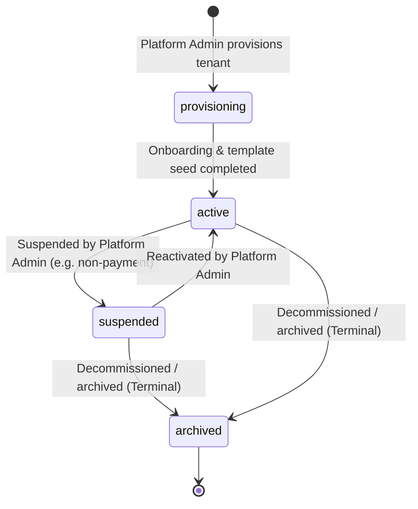

### Transition Matrix
| Source State | Target State | Triggering Event / Action | Permitted Principal | Side Effects / Enforcement |
|---|---|---|---|---|
| `[*]` | `provisioning` | Provisioning API called | `PLATFORM_ADMIN` | Tenant record created; default schema and config seeded |
| `provisioning` | `active` | Initial activation & template seeding complete | `PLATFORM_ADMIN` / System | `seed_tenant_defaults()` executed; Owner invitation activated |
| `active` | `suspended` | Tenant suspension | `PLATFORM_ADMIN` | `TenantStatusCache` invalidated; all Customer API calls return 403 via `SuspendedTenantInterceptor` |
| `suspended` | `active` | Tenant reactivation | `PLATFORM_ADMIN` | `TenantStatusCache` cleared; Customer API access immediately restored |
| `active` / `suspended` | `archived` | Tenant archival / decommissioning | `PLATFORM_ADMIN` | Terminal state; tenant records retained for statutory compliance |

---

## 2. User Invite Tokens (`invite_tokens`)
**Migration:** `V006__app_users_and_roles.sql`  
**Database Constraint:** `CHECK (status IN ('pending', 'accepted', 'expired', 'cancelled'))`

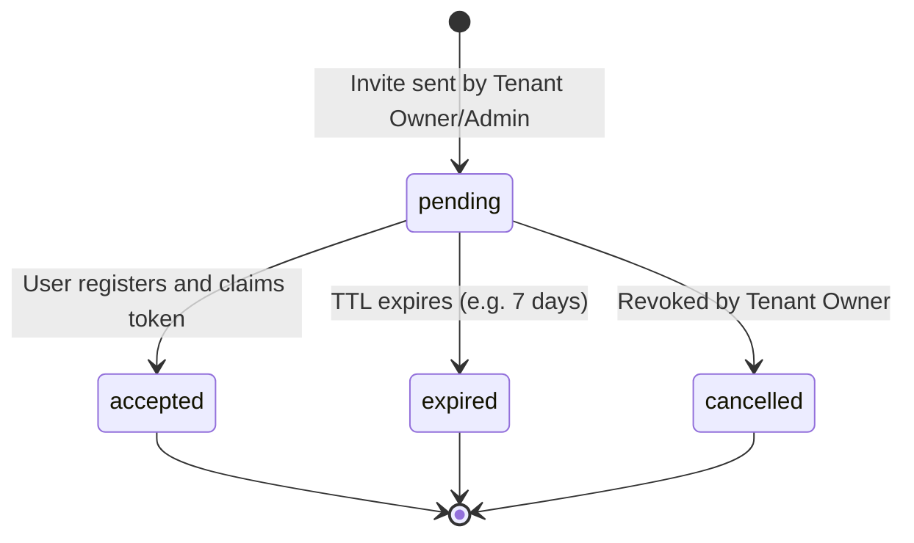

### Transition Matrix
| Source State | Target State | Triggering Event / Action | Permitted Principal | Side Effects / Enforcement |
|---|---|---|---|---|
| `[*]` | `pending` | User invited via Customer API | `OWNER`, `OPS_MANAGER` | Invite token minted; email/notification dispatched |
| `pending` | `accepted` | Token claimed during auth registration | Invited User | `app_users` record created/activated; roles bound to tenant |
| `pending` | `expired` | Token TTL elapsed without claim | System / Clock | Token rejected on subsequent activation attempts |
| `pending` | `cancelled` | Invite revoked by administrator | `OWNER`, `OPS_MANAGER` | Token invalidated immediately |

---

## 3. Customer RFQs (`rfqs`)
**Migration:** `V018__rfqs.sql`  
**Database Constraint:** `CHECK (status IN ('draft', 'sent', 'closed', 'cancelled'))`

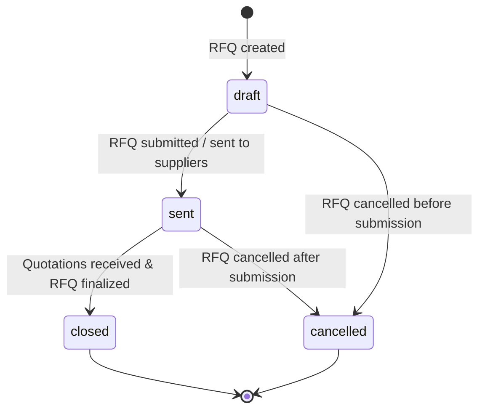

### Transition Matrix
| Source State | Target State | Triggering Event / Action | Permitted Principal | Side Effects / Enforcement |
|---|---|---|---|---|
| `[*]` | `draft` | Create RFQ | `SALES_MANAGER`, `OWNER` | Lines and item specs drafted |
| `draft` | `sent` | Send RFQ to suppliers / portal | `SALES_MANAGER`, `OWNER` | RFQ locked for supplier responses |
| `sent` | `closed` | Finalize RFQ evaluation | `SALES_MANAGER`, `OWNER` | Basis for quotation creation |
| `draft` / `sent` | `cancelled` | Cancel RFQ | `SALES_MANAGER`, `OWNER` | RFQ marked cancelled; pending supplier interactions terminated |

---

## 4. Quotations (`quotations`)
**Migration:** `V019__quotations.sql`  
**Database Constraint:** `CHECK (status IN ('draft', 'sent', 'accepted', 'rejected', 'expired', 'superseded'))`

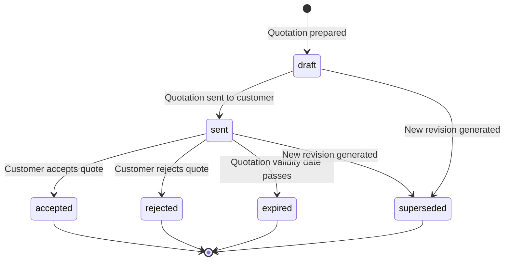

### Transition Matrix
| Source State | Target State | Triggering Event / Action | Permitted Principal | Side Effects / Enforcement |
|---|---|---|---|---|
| `[*]` | `draft` | Prepare Quotation | `SALES_MANAGER`, `OWNER` | Commercial terms and line pricing drafted |
| `draft` | `sent` | Issue Quotation | `SALES_MANAGER`, `OWNER` | Pricing frozen; sent to customer via PDF/portal |
| `sent` | `accepted` | Customer confirms order | `SALES_MANAGER`, `OWNER` | Triggers CPO creation workflow |
| `sent` | `rejected` | Customer declines offer | `SALES_MANAGER`, `OWNER` | Reason recorded; commercial lines archived |
| `sent` | `expired` | `valid_until` date passed | System / Clock | Cannot be converted to CPO without revision |
| `draft` / `sent` | `superseded` | Revised quotation issued | `SALES_MANAGER`, `OWNER` | Superseded by revision `v{N+1}` |

---

## 5. Customer Purchase Orders — CPO (`cpos`)
**Migration:** `V020__cpos.sql`  
**Database Constraint:** `CHECK (status IN ('open', 'partial', 'fulfilled', 'cancelled', 'on_hold'))`

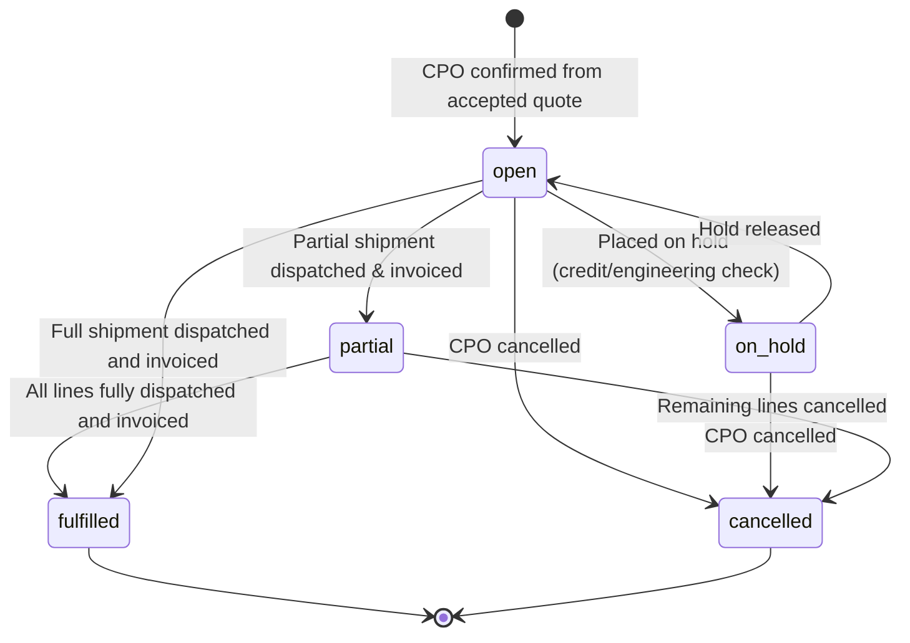

### Transition Matrix
| Source State | Target State | Triggering Event / Action | Permitted Principal | Side Effects / Enforcement |
|---|---|---|---|---|
| `[*]` | `open` | Record customer PO | `SALES_MANAGER`, `OWNER` | Production jobs and inventory reservations linked |
| `open` | `on_hold` | Place CPO on hold | `SALES_MANAGER`, `OWNER` | Temporarily halts dispatch and production release |
| `on_hold` | `open` | Resume CPO execution | `SALES_MANAGER`, `OWNER` | Dispatch and production resumed |
| `open` | `partial` | First partial dispatch completed | System / Dispatcher | Dispatched quantities updated against line items |
| `partial` / `open` | `fulfilled` | Final shipment delivered & closed | System / Accounts | All delivered quantities match ordered quantities |
| `open` / `partial` | `cancelled` | Order cancellation | `SALES_MANAGER`, `OWNER` | Open reservations released; unreleased production jobs cancelled |

---

## 6. Purchase Requisitions — PR (`purchase_requisitions`)
**Migration:** `V021__purchase_requisitions.sql`  
**Database Constraint:** `CHECK (status IN ('draft', 'submitted', 'approved', 'rejected', 'cancelled', 'fulfilled'))`

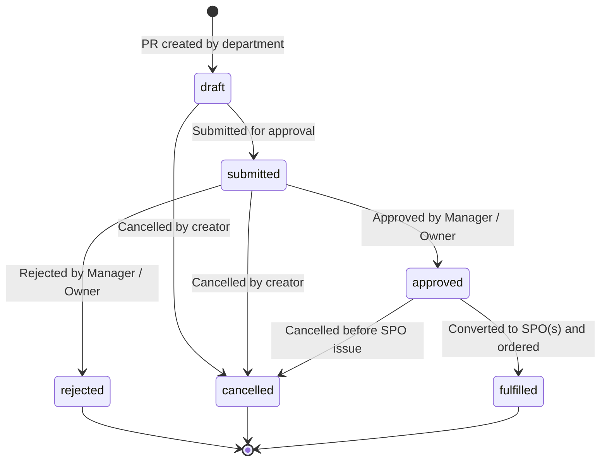

### Transition Matrix
| Source State | Target State | Triggering Event / Action | Permitted Principal | Side Effects / Enforcement |
|---|---|---|---|---|
| `[*]` | `draft` | Create PR | `OPS_MANAGER`, `PRODUCTION_SUPERVISOR`, `STORE_KEEPER`, `OWNER` | Material demand and suggested vendor entered |
| `draft` | `submitted` | Submit for approval | Creator | Locked for editing; pending approval |
| `submitted` | `approved` | Approve PR | `PURCHASE_MANAGER`, `OPS_MANAGER`, `OWNER` | Eligible for consolidation into Supplier Purchase Order |
| `submitted` | `rejected` | Reject PR | `PURCHASE_MANAGER`, `OPS_MANAGER`, `OWNER` | Rejection comments recorded; creator notified |
| `approved` | `fulfilled` | All lines linked to issued SPOs | System / `PURCHASE_MANAGER` | Requisition satisfied |
| `draft` / `submitted` / `approved` | `cancelled` | Cancel requisition | Creator / `PURCHASE_MANAGER` | Requisition closed |

---

## 7. Supplier Quotations (`supplier_quotations`)
**Migration:** `V022__supplier_quotations.sql`, reconciled by `V071__supplier_quotation_spo_lifecycle.sql`
**Database Constraint:** `CHECK (status IN ('requested', 'received', 'under_review', 'selected', 'rejected'))`

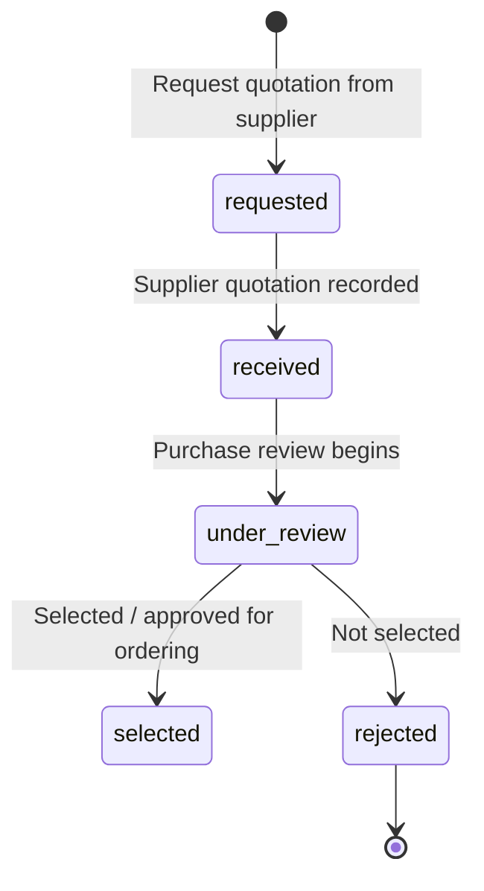

### Transition Matrix
| Source State | Target State | Triggering Event / Action | Permitted Principal | Side Effects / Enforcement |
|---|---|---|---|---|
| `[*]` | `requested` | Request a quotation against an approved PR | `PURCHASE_MANAGER`, `OWNER` | Tenant, supplier, and PR relationships are validated; creation is audited |
| `requested` | `received` | Record the supplier's quote and lines | `PURCHASE_MANAGER`, `OWNER` | Quote remains linked to its supplier and PR; change is audited |
| `received` | `under_review` | Begin comparison/review | `PURCHASE_MANAGER`, `OWNER` | No order or inventory side effect |
| `under_review` | `selected` | Select/approve the quotation | `PURCHASE_MANAGER`, `OWNER` | Selection is the approval required to create an SPO; change is audited |
| `under_review` | `rejected` | Reject the quotation | `PURCHASE_MANAGER`, `OWNER` | Rejected quotations cannot be used to create an SPO; change is audited |

`selected` and `rejected` are terminal quotation states. A selected quotation remains the approved source of its SPO; it is not changed when the SPO is later received or cancelled. Invalid transitions are rejected by the procurement service. Every transition is tenant-scoped, role-checked, transactional, and audited through `AuditService`.

---

## 8. Supplier Purchase Orders — SPO (`spos`)
**Migration:** `V023__spos.sql`, reconciled by `V071__supplier_quotation_spo_lifecycle.sql`
**Database Constraint:** `CHECK (status IN ('draft', 'issued', 'acknowledged', 'partially_received', 'fully_received', 'cancelled'))`

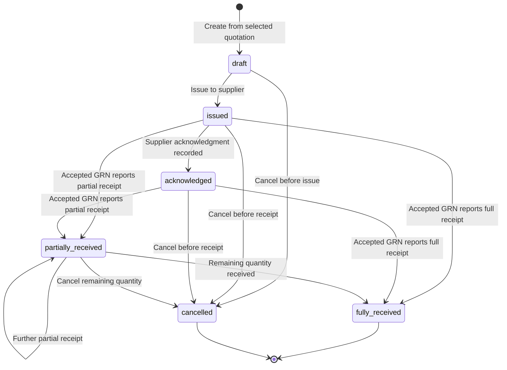

### Transition Matrix
| Source State | Target State | Triggering Event / Action | Permitted Principal | Side Effects / Enforcement |
|---|---|---|---|---|
| `[*]` | `draft` | Create from a selected quotation | `PURCHASE_MANAGER`, `OWNER` | Quotation, PR, supplier, and tenant must match; quotation reference is mandatory; creation is audited |
| `draft` | `issued` | Issue order to supplier | `PURCHASE_MANAGER`, `OWNER` | Outgoing communication is outside this story; transition is audited |
| `draft` | `cancelled` | Cancel an unissued order | `PURCHASE_MANAGER`, `OWNER` | No receiving or inventory effects |
| `issued` | `acknowledged` | Record supplier acknowledgment | `PURCHASE_MANAGER`, `OWNER` | Acknowledgment is recorded and audited |
| `issued` / `acknowledged` | `partially_received` / `fully_received` | Accepted GRN updates receipt progress | Receiving workflow in Issue #51 | Receipt quantities and inventory are owned by Issue #51; this story does not implement GRNs or inventory updates |
| `partially_received` | `partially_received` | Accept another GRN without completing the order | Receiving workflow in Issue #51 | Receipt quantities are owned by Issue #51 |
| `partially_received` | `fully_received` | Accepted GRN completes ordered quantities | Receiving workflow in Issue #51 | Receipt quantities are owned by Issue #51 |
| `issued` / `acknowledged` / `partially_received` | `cancelled` | Cancel order or remaining quantity | `PURCHASE_MANAGER`, `OWNER` | Already received quantities are not reversed; transition is audited |

`fully_received` and `cancelled` are terminal. Supplier-bill matching and financial close do not add another SPO status in this lifecycle. Receiving-driven status changes are implemented with Issue #51, not by the quotation/SPO APIs in Issue #48. Invalid transitions are rejected server-side; every transition is tenant-scoped, role-checked, transactional, and audited through `AuditService`.

---

## 9. Goods Received Notes — GRN (`grns`)
**Migration:** `V024__grns.sql`  
**Database Constraint:** `CHECK (status IN ('draft', 'inspected', 'accepted', 'partially_accepted', 'rejected', 'closed'))`

```mermaid
stateDiagram-v2
    [*] --> draft: Inward shipment received at gate
    draft --> inspected: Quality inspection logged
    inspected --> accepted: 100% quantity accepted
    inspected --> partially_accepted: Accepted with concessions or partial rejection
    inspected --> rejected: 100% quantity rejected (NCR raised)
    accepted --> closed: Stock moved to available inventory
    partially_accepted --> closed: Accepted stock moved; rejected quarantined
    rejected --> closed: Material quarantined / return to vendor
    closed --> [*]
```

### Transition Matrix
| Source State | Target State | Triggering Event / Action | Permitted Principal | Side Effects / Enforcement |
|---|---|---|---|---|
| `[*]` | `draft` | Gate receipt logged | `STORE_KEEPER`, `OPS_MANAGER`, `OWNER` | Inward batch/lot tagged; awaits QA inspection |
| `draft` | `inspected` | Inspection report submitted | `QUALITY_INSPECTOR`, `OPS_MANAGER`, `OWNER` | Quality measurements recorded |
| `inspected` | `accepted` | Full acceptance | `QUALITY_INSPECTOR`, `OPS_MANAGER`, `OWNER` | Stock movement queued to `available` stock |
| `inspected` | `partially_accepted` | Concession granted or partial reject | `OPS_MANAGER`, `OWNER` (concession required) | NCR created for non-conforming items |
| `inspected` | `rejected` | Full batch rejection | `QUALITY_INSPECTOR`, `OPS_MANAGER`, `OWNER` | Stock moved to `quarantine`; return to vendor logged |
| `accepted` / `partially_accepted` / `rejected` | `closed` | Movements executed and GRN finalized | `STORE_KEEPER`, `OPS_MANAGER` | Stock ledger confirmed; stock movement trigger enforced |

---

## 10. Production Jobs (`production_jobs`)
**Migration:** `V025__production_jobs.sql`  
**Database Constraint:** `CHECK (status IN ('planned', 'released', 'in_progress', 'completed', 'cancelled', 'on_hold'))`

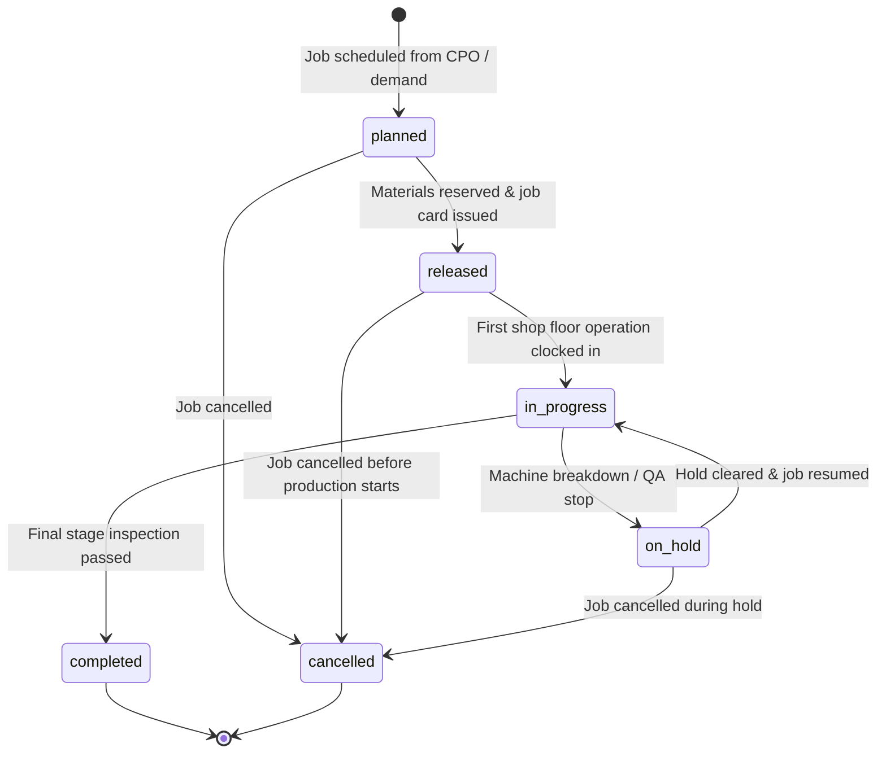

### Transition Matrix
| Source State | Target State | Triggering Event / Action | Permitted Principal | Side Effects / Enforcement |
|---|---|---|---|---|
| `[*]` | `planned` | Job scheduled | `OPS_MANAGER`, `PRODUCTION_SUPERVISOR`, `OWNER` | Routing and BOM allocated |
| `planned` | `released` | Material issued to shop floor | `PRODUCTION_SUPERVISOR`, `OPS_MANAGER`, `OWNER` | Stock movement from warehouse to shop floor WIP |
| `released` | `in_progress` | Job operations started | `PRODUCTION_SUPERVISOR`, `FIELD_WORKER` | Stage completion tracking initiated |
| `in_progress` | `on_hold` | Quality stop or shortage | `PRODUCTION_SUPERVISOR`, `QUALITY_INSPECTOR`, `OPS_MANAGER` | Production paused; issue logged |
| `on_hold` | `in_progress` | Root cause resolved | `OPS_MANAGER`, `PRODUCTION_SUPERVISOR` | Production resumed |
| `in_progress` | `completed` | Final QA approval and quantity produced | `QUALITY_INSPECTOR`, `PRODUCTION_SUPERVISOR`, `OPS_MANAGER` | Finished goods moved to FG inventory lot |
| `planned` / `released` / `on_hold` | `cancelled` | Job cancelled | `OPS_MANAGER`, `OWNER` | Work-in-progress accounted for; material returned |

---

## 11. Customer Invoices (`invoices`)
**Migration:** `V031__invoices.sql`  
**Database Constraint:** `CHECK (status IN ('draft', 'issued', 'paid', 'partially_paid', 'overdue', 'cancelled', 'credit_note'))`

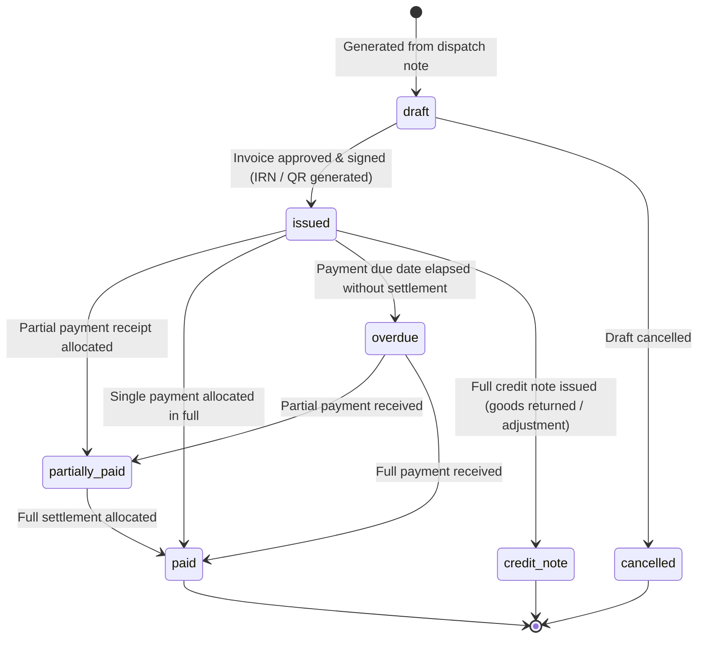

### Transition Matrix
| Source State | Target State | Triggering Event / Action | Permitted Principal | Side Effects / Enforcement |
|---|---|---|---|---|
| `[*]` | `draft` | Create invoice from dispatch | `ACCOUNTS_STAFF`, `OWNER` | GST calculation performed; line amounts calculated |
| `draft` | `issued` | Issue official tax invoice | `ACCOUNTS_STAFF`, `OWNER` | Sequential numbering assigned; IRN/E-way bill minted; tax ledger posted |
| `issued` / `overdue` | `partially_paid` | Payment receipt allocated | `ACCOUNTS_STAFF`, `OWNER` | Balance remaining updated; customer statement updated |
| `partially_paid` / `issued` / `overdue` | `paid` | Outstanding amount reaches 0 | System / `ACCOUNTS_STAFF` | Invoice settled |
| `issued` | `overdue` | `due_date < CURRENT_DATE` & balance > 0 | System / Nightly Job | Aging report and dunning alerts triggered |
| `draft` | `cancelled` | Draft discarded | `ACCOUNTS_STAFF`, `OWNER` | Invoice voided prior to statutory numbering |
| `issued` / `overdue` | `credit_note` | Credit note adjustment issued | `ACCOUNTS_STAFF`, `OWNER` | Reversing tax ledger entry posted |

---

## 12. Concessions & NCRs (`concessions`, `ncrs`)
**Migration:** `V028__ncrs_and_concessions.sql`  
**Database Constraints:**  
- `ncrs.status IN ('open', 'under_review', 'resolved', 'closed', 'scrapped')`  
- `concessions.status IN ('pending', 'approved', 'rejected')`

### Concession Approval Rules (Founder Decision)
- Concessions may **ONLY** be approved or rejected by **`OWNER`** or **`OPS_MANAGER`**.
- `QUALITY_INSPECTOR` may identify non-conformities and raise NCRs/concession requests, but **CANNOT** approve concessions (pending unresolved founder decision review).
- Every approved concession requires a recorded technical disposition justification and mandatory audit log entry.
